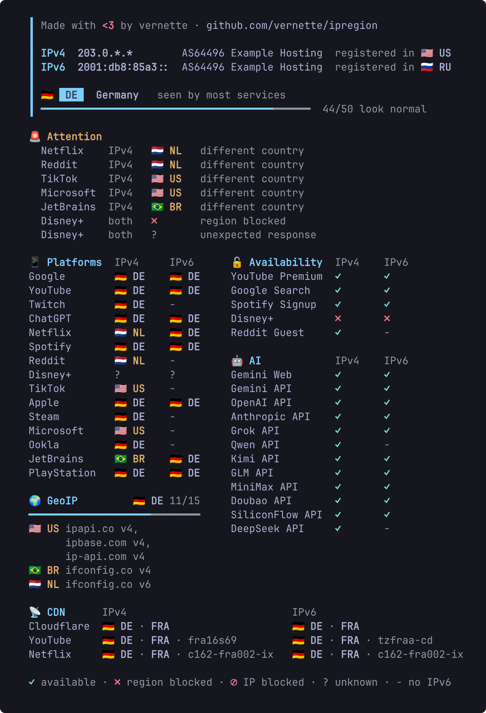

<h1 align="center">ipregion</h1>

<p align="center">See which country GeoIP databases, popular platforms, CDNs and AI services think your server is in, over IPv4 and IPv6.</p>

<p align="center">
  <a href="https://github.com/vernette/ipregion/actions/workflows/test.yml"></a>
  <a href="https://github.com/vernette/ipregion/actions/workflows/live.yml"></a>
  <a href="https://github.com/vernette/ipregion/actions/workflows/build-docker.yml"></a>
  <a href="https://hub.docker.com/r/vernette/ipregion"></a>
  <a href="LICENSE"></a>
</p>

## Contents

- [Features](#features)
- [Dependencies](#dependencies)
- [Output](#output)
- [Usage](#usage)
- [Docker](#docker)
- [Options](#options)
- [How the checks work](#how-the-checks-work)
- [JSON](#json)
- [Country codes](#country-codes)
- [Contributing](#contributing)

## Features

- Shows how GeoIP databases, popular platforms, CDNs and AI services see the host, side by side for IPv4 and IPv6
- Verdict - the country most services agree on - and an Attention list of everything that disagrees or is blocked
- Groups: Platforms (YouTube, Netflix, ChatGPT, ...), Availability (YouTube Premium, Google Search, ...), AI (Gemini, OpenAI, Anthropic, Chinese providers), CDN edge nodes, GeoIP databases
- SOCKS5 proxy, custom network interface, JSON output
- Installs missing dependencies automatically on Debian, Ubuntu, Fedora, RHEL, Rocky, Alma, Arch, openSUSE, Alpine, Void and Termux

## Dependencies

- bash 4.4+ (on macOS: `brew install bash`)
- curl
- jq

## Output



> [!NOTE]
> Country flags and group icons are shown with `--emoji`. Emoji rendering differs between terminals: some show flags as two letters or shift the columns

- Attention lists services that see another country or are blocked
- GeoIP shows a summary; `--geoip-breakdown` lists every service
- Colors are used only on a terminal and are disabled by `NO_COLOR`

## Usage

### Download and run locally

```bash
wget -O ipregion.sh https://ipregion.vrnt.xyz
chmod +x ipregion.sh
```

### Run directly from GitHub

```bash
wget -qO- https://ipregion.vrnt.xyz | bash
```

Options go after `bash -s --`:

```bash
wget -qO- https://ipregion.vrnt.xyz | bash -s -- --group ai --ipv4
```

### Mirror (proxy through server)

If direct access to GitHub is unreliable or slow for you, use the mirror domain. It fetches the script through the server instead of redirecting you to GitHub:

```bash
# Download and run locally
wget -O ipregion.sh https://ipregion.mirror.vrnt.xyz
chmod +x ipregion.sh

# Run directly
wget -qO- https://ipregion.mirror.vrnt.xyz | bash
```

> [!NOTE]
> Unlike `ipregion.vrnt.xyz`, which simply redirects to GitHub, `ipregion.mirror.vrnt.xyz` proxies the request through the server (client -> server -> GitHub). Use it when the primary domain works poorly due to GitHub connectivity issues

## Docker

### Run the container for IPv4 (default Docker bridge network)

This runs your IP geolocation check using IPv4 only, without requiring host network mode:

```bash
docker run --rm vernette/ipregion:latest
```

You can append additional script options as needed, for example:

```
docker run --rm vernette/ipregion:latest --group geoip
```

### Run the container with host networking (for IPv4 & IPv6 or custom interface)

To access both IPv4 and IPv6 on the host real network interfaces, or to specify a custom network interface (e.g., eth1), use Docker host network mode:

```bash
docker run --rm --network=host vernette/ipregion:latest
```

```bash
docker run --rm --network=host vernette/ipregion:latest --interface eth1
```

> [!NOTE]
> When using `--network=host`, the container shares the host network stack, which reduces network isolation but enables full access to interfaces. Without `--network=host`, the container uses Docker bridge network, which may not expose IPv6 or allow interface selection

## Options

```bash
./ipregion.sh --help                        # Show all options
./ipregion.sh --group platforms,ai          # Only these groups: platforms cdn availability ai geoip
./ipregion.sh --service steam,geoip/ripe    # Only these services, names from --list-services
./ipregion.sh --group ai --service chatgpt  # A whole group plus single services from other groups
./ipregion.sh --ipv4                        # IPv4 only
./ipregion.sh --ipv6                        # IPv6 only
./ipregion.sh --proxy 127.0.0.1:1080        # Use a SOCKS5 proxy, it picks IPv4 or IPv6 itself
./ipregion.sh --interface eth1              # Use a network interface
./ipregion.sh --timeout 10                  # Request timeout in seconds
./ipregion.sh --emoji                       # Country flags and group icons
./ipregion.sh --geoip-breakdown             # Every GeoIP service instead of the summary
./ipregion.sh --youtube-lang en             # YouTube interface language for YouTube No Ads (default: ru)
./ipregion.sh --json                        # JSON output
./ipregion.sh --verbose                     # Log every request to stderr
./ipregion.sh --debug                       # Save a masked trace and offer to upload it
./ipregion.sh --yes                         # Install dependencies and upload the debug log without asking
```

All options can be combined. A service that exists in several groups needs the group prefix: `platforms/netflix` or `cdn/netflix`.

## How the checks work

Every check is one or two plain HTTP requests from the host itself (or through `--proxy` / `--interface`), the same requests a browser or an app would make. No accounts or API keys are needed. Each check runs separately over IPv4 and IPv6, because a host often looks like a different country on each protocol.

The verdict at the top is the country most Platforms and GeoIP services agree on. Attention lists every service that sees another country, is blocked or failed; the counter shows how many checks look normal.

### Statuses

| Symbol | Meaning                                                        |
| ------ | -------------------------------------------------------------- |
| `✓`    | Works (in Availability: good for you)                          |
| `✗`    | Blocked for the country of this IP                             |
| `⊘`    | Blocked for this IP itself (datacenter or VPN ranges, captcha) |
| `?`    | No answer or an unexpected one - the reason is in Attention    |
| `-`    | Not checked: the host or the service has no IPv6               |

### Availability and AI rows

| Row                                    | `✓` means                  | How it is checked                                                                                                                 |
| -------------------------------------- | -------------------------- | --------------------------------------------------------------------------------------------------------------------------------- |
| YouTube Premium                        | Premium can be bought      | The Premium purchase page of the YouTube API has a buy button                                                                     |
| YouTube No Ads RU                      | No video ads in videos     | See below                                                                                                                         |
| Google Search                          | No captcha                 | A search is not redirected to the `/sorry/` captcha page                                                                          |
| Spotify Signup                         | Sign-up is open            | Spotify's sign-up validation reports the country as launched                                                                      |
| Disney+                                | Disney+ serves the country | Disney's device registration reports a supported location                                                                         |
| Reddit Guest                           | Reddit opens without login | The front page is not answered with 403                                                                                           |
| Gemini Web / Gemini API                | Gemini is available        | The Google country of the IP is in Google's official list of Gemini regions                                                       |
| OpenAI / Anthropic / Grok API          | The API serves the region  | A request without a key gets "unauthorized" (`✓`) instead of the provider's "unsupported country" error (`✗`); another 403 is `⊘` |
| Chinese AI APIs (Qwen, Kimi, GLM, ...) | The API is reachable       | They do not block regions, so only reachability is checked                                                                        |

### YouTube No Ads

Whether YouTube plays video ads (before and inside videos) depends on the IP and on the language of the YouTube interface. The same server can show video ads to one viewer and none to another: for example, on a Swedish VPS we tested a viewer with the Russian interface gets no video ads, while the English interface gets them. On a German VPS both get them. The check is only about ads in videos: YouTube shows banner ads in its interface (home page, search, next to the player) anyway, including on the Swedish VPS that plays no ads in videos.

The check opens a monetized video page twice with the chosen interface language (`--youtube-lang`, `ru` by default, shown in the row name). The first visit only receives the visitor cookies - YouTube does not assign ads to a visitor without them - and the second one looks for a video ad slot in the page. `✓` means no video ad slot, `✗` means video ads (reason `video ads` in Attention). Run with your own language to see what you will get:

```bash
./ipregion.sh --service youtube_no_ads --youtube-lang en
```

## JSON

`--json` prints a report described by the schema [`schema/ipregion-v2.schema.json`](schema/ipregion-v2.schema.json):

```json
{
  "$schema": "https://raw.githubusercontent.com/vernette/ipregion/master/schema/ipregion-v2.schema.json",
  "version": 2,
  "ipv4": {
    "ip": "203.0.113.10",
    "asn": 64496,
    "org": "Example Hosting",
    "registered": "NL",
    "maxmind_failure": null
  },
  "ipv6": null,
  "verdict": {
    "country": "SE",
    "tied": []
  },
  "attention": [
    {
      "services": ["JetBrains"],
      "ip_version": "4",
      "country": "SI",
      "access": null,
      "reason": "different country"
    }
  ],
  "results": {
    "platforms": [
      {
        "id": "google",
        "service": "Google",
        "ipv4": {
          "country": "SE",
          "access": null,
          "reason": null
        },
        "ipv6": null,
        "proxy": null
      }
    ],
    "cdn": [
      {
        "id": "cloudflare",
        "service": "Cloudflare",
        "ipv4": {
          "country": "SE",
          "access": null,
          "reason": null,
          "iata": "ARN",
          "node": null
        },
        "ipv6": null,
        "proxy": null
      }
    ],
    "availability": [
      {
        "id": "youtube_premium",
        "service": "YouTube Premium",
        "ipv4": {
          "country": null,
          "access": "yes",
          "reason": null
        },
        "ipv6": null,
        "proxy": null
      }
    ],
    "ai": [],
    "geoip": []
  }
}
```

- `ipv4` / `ipv6` - `null` when the protocol is not available or not selected
- `verdict.country` - `null` on a tie, then the tied countries are in `verdict.tied`
- `access` - `yes`, `no` (region blocked) or `ipblock` in Availability and AI, always `null` in the other groups. For `youtube_no_ads` `no` means video ads (`reason: "video ads"`); its `service` carries the language, e.g. `YouTube No Ads RU`
- `proxy` - set only through a proxy that exits over both IPv4 and IPv6. Such a proxy picks the protocol of each connection itself, so Platforms, Availability, AI and CDN are checked once: the result is under `proxy`, `ipv4` / `ipv6` are `null`. GeoIP stays per protocol, because its services are asked about each exit IP explicitly; Cloudflare reports the address it saw, so the other protocol gets `reason: "proxy picked IPv4"` or `"proxy picked IPv6"`. Through a proxy with one protocol everything stays under `ipv4` or `ipv6`
- `ip_version` in Attention - `4`, `6`, `both` or `proxy`

## Country codes

The script outputs country codes in ISO 3166-1 alpha-2 format (e.g., RU, US, DE).

You can look up the meaning of any country code at the official ISO website: [https://www.iso.org/obp/ui/#search/code/](https://www.iso.org/obp/ui/#search/code/)

Just enter the code in the search box to get the full country name.

## Contributing

Contributions are welcome! Feel free to submit pull requests to add new services or improve the script's functionality.


